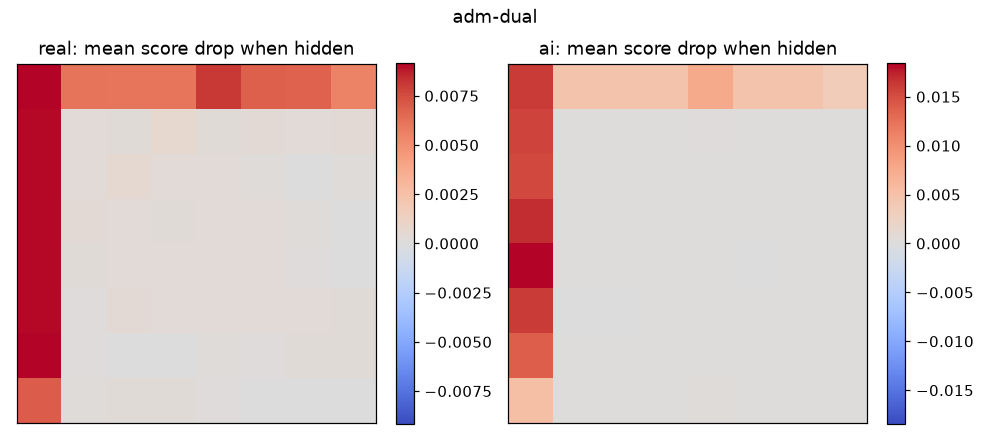
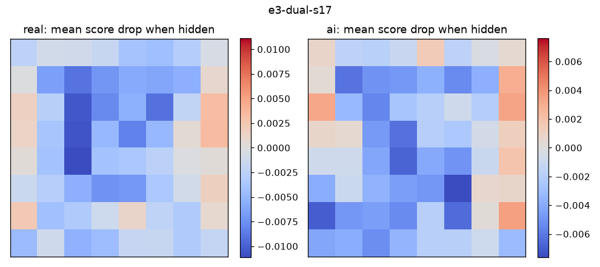
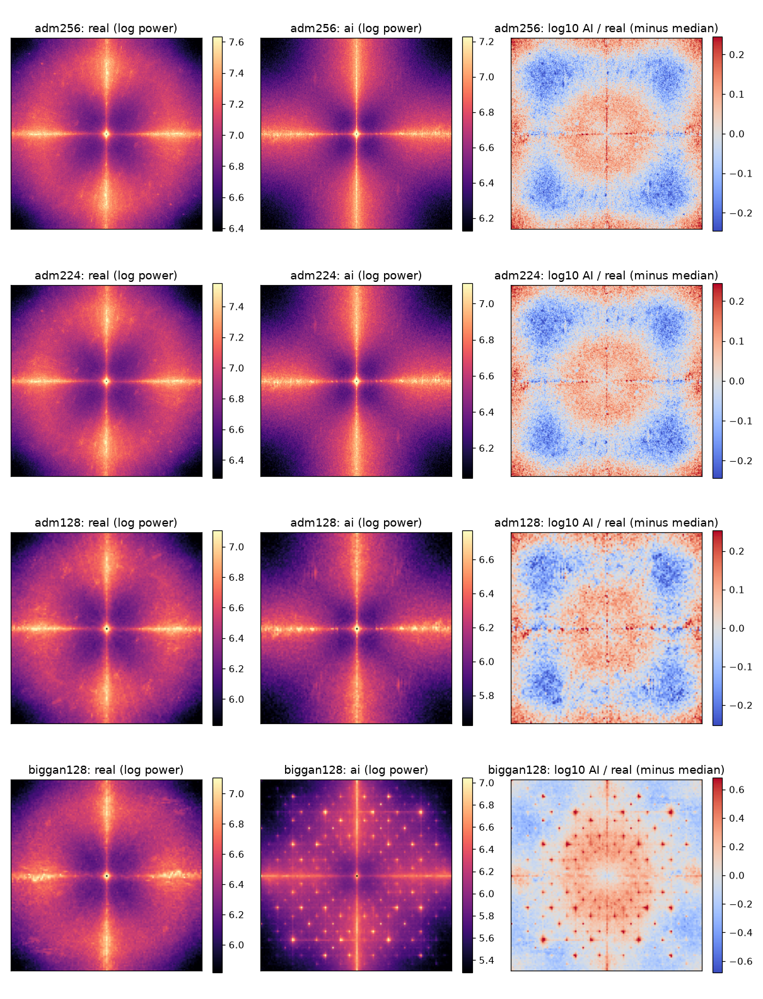

# Experiment results (run of 2026-11-19/20)

Branch: `test`. Plan and setup: [`experiment_plan.md`](experiment_plan.md). Runner: [`scripts/run_experiment_plan.sh`](../scripts/run_experiment_plan.sh).
All numbers come from one CPU machine (16 cores, no GPU) and, unless stated otherwise, **one seed (17)**.

## TL;DR for the team

1. **Our earlier "AUROC 1.0" on ADM was a shortcut, not detection.** Generated ADM images are whole pictures with edge artefacts; real ImageNet images are crops from inside a photo. The 256 px models looked at the image border. Greying out a 16 px border dropped the old baseline from 1.000 to 0.676 and the old dual model to 0.429. **Do not quote the old 256 px numbers anywhere.**
2. All new training data is **cropped to the image interior for both classes** (`adm224`, inner 224 of the 256 images). On this border-free data: **dual-resolution 0.897 AUROC, local-only 0.897, global-only baseline 0.847.** Unseen generator BigGAN: 0.914 / 0.890 / 0.864.
3. **The native-resolution crop carries the signal.** The local branch alone is as good as the fused model on ADM. The global (resized) branch is the weak part.
4. **The models use fine high-frequency detail, not content.** They survive tile shuffling and high-pass filtering, but break under blur/low-pass. Under blur, 62–88 % of real photos are flagged as AI at the validation threshold.
5. **The 0.5 threshold is unusable** (20–43 % false positives on ADM test). Use a threshold calibrated on validation (gives 2–5 % FPR on clean test data).
6. **Training augmentation (blur + JPEG) trades accuracy for calibration**: −0.08 to −0.12 AUROC on clean data, but blurred real photos flagged as AI drop from 62 % to 15 %.
7. **Train on BigGAN → test on ADM generalises poorly (0.72)**, although BigGAN itself is separated almost perfectly (0.996). The other direction (ADM → BigGAN) works much better (0.86–0.91).
8. **The run is incomplete**: the computer restarted at about 03:20 on 2026-11-20 during experiment 6 (dual model). See [Status](#status-and-how-to-resume).

## Status and how to resume

| Experiment | Status |
| --- | --- |
| 1 Border shortcut, 2 thresholds, 11 spectra, 13 occlusion, 22 bootstrap CIs | done |
| 3/4/5 baseline vs local-only vs dual, 15 epochs, seed 17 | done |
| 7 robustness, 12 frequency bands, 14 tile shuffling (on seed-17 models) | done |
| 15 augmentation (baseline + dual) | done |
| 6 train BigGAN → test ADM | baseline done (+ ADM 112 reference); **dual interrupted** |
| 21 joint ADM+BigGAN, 16 data scaling, 17 local crop size, 18 capacity | not started (data is built) |
| 3 seeds 29 and 43 | not started |
| 19 real photos from other sources | blocked: needs non-ImageNet real photos |
| 20 more generators | blocked: only ADM and BigGAN archives are usable (GLIDE has 0 readable AI images, the other folders are empty) |

Resume (the runner skips everything that is finished and restarts the interrupted run from scratch):

```bash
bash scripts/run_experiment_plan.sh ablations seeds
```

Remaining time on this CPU, estimated from the finished runs: about 14 h (ablations ≈ 6 h, two more seeds ≈ 7.5 h, plus evaluation).

Typical durations: baseline 15 epochs ≈ 25 min, local-only ≈ 70 min, dual ≈ 80 min, evaluation of one model on all test sets ≈ 10 min.

## What changed in the data pipeline (read this before training anything)

* **Debiased GenImage builds** ([`scripts/prepare_genimage.py`](../scripts/prepare_genimage.py)): reads the split ZIPs in place, takes a JPEG-grid-aligned centre crop of each real image, and JPEG-compresses each AI image with quality/subsampling drawn from the real images. Without this, "PNG vs JPEG" and image size alone separate the classes (Grommelt et al., 2024, "Fake or JPEG?").
* **Border-free crops**: `data/genimage_adm_224` (inner 224 px) for training, `adm112` / `biggan112` (inner 112 px) for the cross-generator runs. Built with `python -m scripts.experiments perturb <manifest> all <out> crop:224`.
* **Builder fixes from this run** (in [`src/data/genimage.py`](../src/data/genimage.py), with tests): archive members that are not decodable images are skipped, and byte-identical duplicate images are written only once. The ADM archive contained 1 undecodable AI image and 2 duplicate real photos within the first 20k; the BigGAN archive had 1 duplicate real photo. Before the fix the 20k build crashed.
* Default views are now 128×128 (global resized view and native local crop).
* `data/` and `outputs/` are not in git. Every dataset can be rebuilt from `C:\data\ADM` and `C:\data\BigGAN` with the commands in the runner script.

## Test sets

All from GenImage `val/`, 1,000 real + 1,000 AI each, debiased.

| Name | Content |
| --- | --- |
| `adm224` | **Main test set.** ADM, inner 224 px, border-free |
| `adm256` | ADM full 256 px, with borders (shortcut check) |
| `adm128` | ADM centre 128 px |
| `biggan128` | BigGAN native 128 px (unseen generator) |
| `biggan128_border8` | BigGAN with an 8 px grey border on both classes |
| `adm112`, `biggan112` | inner 112 px, for the 112 px runs of experiment 6 |
| `adm224_<op>` | `adm224` with a perturbation applied identically to both classes |

Metrics: AUROC with 95 % bootstrap interval (1,000 class-stratified resamples), TPR at 5 % FPR, and FPR/TPR at the threshold that gave 5 % FPR on validation ("val threshold").

## Results

### Experiment 1 – the border shortcut (old 256 px checkpoints)

The old checkpoints (`outputs/adm-baseline`, `outputs/adm-dual`) were trained on full 256 px ADM images. Borders were modified identically for both classes.

| Test (ADM 256) | Old baseline | Old dual |
| --- | --- | --- |
| unchanged | 1.000 | 1.000 |
| 16 px grey border | 0.676 | 0.429 |
| 32 px grey border | 0.668 | 0.443 |
| 32 px reflected border | 0.559 | 0.405 |
| JPEG 50 / resample ×0.75 / blur σ=1 | 1.000 / 1.000 / 0.999 | 1.000 / 1.000 / 0.999 |
| ADM 224 (border cropped off) | 0.594 | 0.539 |
| BigGAN 128 | 0.499 | 0.571 |

Compression, resampling and blur do not hurt at all, but removing the border does. The old dual model even falls below chance, so it learnt "this border looks like ADM". Occlusion maps (experiment 13) agree: hiding a border cell changes the score 3.8× (baseline) and 124× (dual) more than hiding an interior cell, mostly the top row and left column.



The old 128 px models (`outputs/adm128-*`) were trained on a centre 128 crop, which avoids most of the border. They reach 0.741 (baseline) and 0.800 (dual) on `adm128`, and 0.78–0.81 on BigGAN.

### Experiments 3, 4, 5 – baseline vs. local-only vs. dual (seed 17, border-free, 15 epochs, cosine LR)

| Test set | Baseline (global only) | Local only | Dual-resolution |
| --- | --- | --- | --- |
| validation AUROC | 0.843 | 0.866 | **0.887** |
| **adm224** AUROC | 0.847 [0.830–0.863] | 0.897 [0.885–0.910] | **0.897** [0.884–0.911] |
| adm224 TPR @ 5 % FPR | 25.6 % | 47.4 % | **50.2 %** |
| adm128 | 0.755 | **0.897** | 0.855 |
| adm256 (with borders) | 0.845 | 0.897 | 0.924 |
| **biggan128 (unseen)** | 0.864 [0.848–0.880] | 0.890 [0.876–0.904] | **0.914** [0.902–0.926] |
| biggan128 TPR @ 5 % FPR | 17.9 % | 29.3 % | **49.7 %** |
| biggan128_border8 | 0.847 | 0.883 | 0.898 |

Notes:

* The local-only model gives identical numbers on adm128/224/256. That is expected: its evaluation crop is the image centre, which is the same pixels in all three sets.
* Dual is better on `adm256` (0.924) than on `adm224` (0.897): its global branch still picks up some border information when borders are present. Keep evaluating on border-free data.
* **Experiment 5 (training length):** validation AUROC was still rising at epoch 15 for all three models (dual: 0.796 after 6 epochs, 0.887 after 15). Longer training will probably help.
* Occlusion maps of the new models show no border preference (border/interior ratio 0.66–0.77, versus 3.8 and 124 before).



### Experiment 2 – thresholds

On `adm224`:

| Model | at 0.5: FPR / TPR | at val threshold: FPR / TPR |
| --- | --- | --- |
| Baseline | 26.5 % / 81.9 % | 5.4 % / 27.2 % |
| Local only | 22.0 % / 85.3 % | 2.4 % / 36.5 % |
| Dual | 19.7 % / 81.9 % | 3.3 % / 36.6 % |

The validation threshold carries over to clean test data (0.7–7.9 % FPR on all clean test sets). It does **not** hold under perturbations (see below). If we ship a decision, it must use a calibrated threshold, and at 5 % FPR we currently catch only about a third to a half of the fakes.

### Experiments 7, 12, 14 – robustness, frequency bands, content (AUROC on `adm224`, val-threshold FPR in brackets)

| Perturbation (both classes) | Baseline | Local only | Dual |
| --- | --- | --- | --- |
| none | 0.847 (5 %) | 0.897 (2 %) | 0.897 (3 %) |
| JPEG 90 | 0.839 (7 %) | 0.880 (4 %) | 0.887 (4 %) |
| JPEG 75 | 0.836 (8 %) | 0.859 (7 %) | 0.874 (6 %) |
| JPEG 50 | 0.829 (9 %) | 0.828 (12 %) | 0.856 (9 %) |
| resample ×0.75 and back | 0.816 (13 %) | 0.809 (19 %) | 0.831 (14 %) |
| **blur σ = 1** | 0.634 (**64 %**) | 0.601 (**81 %**) | 0.677 (**62 %**) |
| **low-pass 0.125 cyc/px** | 0.538 (**88 %**) | 0.492 (**99 %**) | 0.602 (**77 %**) |
| high-pass 0.125 cyc/px | 0.796 (0 %) | 0.865 (0 %) | 0.812 (0 %) |
| shuffle 32 px tiles | 0.787 (5 %) | 0.887 (5 %) | 0.859 (3 %) |
| shuffle 56 px tiles | 0.821 (2 %) | 0.893 (4 %) | 0.872 (4 %) |

* The evidence is in the **high frequencies**: keeping only them costs little, removing them destroys detection.
* Shuffling tiles (content destroyed) barely affects the local model, so it does not rely on semantic content.
* Blur makes real photos look generated (huge FPR), which matches the spectra below: ADM images have less fine noise than real photos.
* JPEG is handled reasonably well, because both classes are JPEG-compressed in training already.

### Experiment 11 – residual spectra

Mean power spectrum of the noise residual (image − 3×3 median), 500 images per class.

| Set | mean log10(AI / real) | peak over median |
| --- | --- | --- |
| ADM 256 / 224 / 128 | −0.40 / −0.39 / −0.34 | 0.38–0.44 |
| BigGAN 128 | −0.47 | **1.38** |

* ADM: about 2.5× **less** residual noise power than real photos (10^0.4), strongest at high diagonal frequencies, **no periodic peaks**.
* BigGAN: also less noise, plus **strong periodic peaks** (the upsampling grid), which is an easy, generator-specific trace.



### Experiment 15 – training augmentation (blur σ ∈ [0, 3] and JPEG q ∈ [30, 100], each p = 0.5)

| Test | Baseline | Baseline + aug | Dual | Dual + aug |
| --- | --- | --- | --- | --- |
| adm224 | **0.847** | 0.768 | **0.897** | 0.776 |
| biggan128 | **0.864** | 0.808 | **0.914** | 0.845 |
| JPEG 50 | 0.829 | 0.765 | 0.856 | 0.770 |
| blur σ=1 (FPR) | 0.634 (64 %) | 0.625 (**24 %**) | 0.677 (62 %) | 0.696 (**15 %**) |
| low-pass (FPR) | 0.538 (88 %) | 0.596 (**30 %**) | 0.602 (77 %) | 0.668 (**16 %**) |

Augmentation makes the models **cautious, not better**: they no longer call blurry real photos AI, but they still cannot separate blurred images and lose accuracy on clean images. Validation AUROC was still noisy and rising at epoch 15 (0.78–0.79), so these models are undertrained. Worth retrying with more epochs or a lower augmentation probability.

### Experiment 6 – train on BigGAN, test on ADM (baseline, inner 112 px, 112 px views, 10 epochs)

| Test | Trained on BigGAN 112 | Trained on ADM 112 (reference) |
| --- | --- | --- |
| validation | 0.994 | 0.824 |
| biggan112 | **0.996** (TPR@5 % 98 %) | 0.874 |
| biggan128 (rescaled 128 → 112) | 0.781 | 0.792 |
| **adm112** | **0.720** | 0.847 |
| adm224 / adm256 (rescaled) | 0.689 / 0.652 | 0.713 / 0.707 |

* BigGAN is easy (0.996 within the generator), but the model learns BigGAN's specific grid and transfers badly to ADM (0.72). ADM-trained models transfer better to BigGAN (0.87 here, 0.86–0.91 in the 224 runs). **Training on the harder generator generalises better.**
* **Scale matters a lot**: the same BigGAN images at 128 px, shrunk to the 112 px view, drop from 0.996 to 0.781, because resampling smears the periodic grid. The ADM 112 model also drops on the 224/256 sets, which have to be downscaled. Test images should be at the training resolution, or scale must be part of training.
* The dual-resolution version of this experiment was interrupted.

## Known limitations

* **Single seed.** Differences smaller than about 0.02–0.03 AUROC are within the bootstrap intervals and may not hold across seeds. Seeds 29 and 43 are still to run.
* **One training generator (ADM), two generators in total.** "Unseen generator" means BigGAN only.
* **Real images are all ImageNet** with standard JPEG tables. False positives on other photo sources (phones, other cameras, social media re-encodes) are untested (experiment 19).
* BigGAN real test images and ADM real test images are both ImageNet `val` and can overlap. This affects only comparisons between test sets, not training.
* The global view of the 224 px main runs is downscaled ×1.75, while `adm128`/`biggan128` are not rescaled. Comparisons of the global branch across these sets mix two effects.
* Absolute numbers are modest (best TPR at 5 % FPR ≈ 50 %). This is a small CPU model trained for 15 epochs on 8,000 images.

## Suggested next steps

1. Resume the runner (ablations + seeds) and add the seed means/spread to this document.
2. Train longer (e.g. 30 epochs): every curve was still rising at the end.
3. Make the global branch scale-robust (random resize in training) or drop it in favour of several local crops. The local crop carries most of the signal.
4. Get non-ImageNet real photos for a false-positive test, and more GenImage generator archives (complete GLIDE, SD 1.4/1.5, Midjourney, VQDM, Wukong).
5. Always report AUROC + TPR at a fixed FPR with a validation-calibrated threshold, never accuracy at 0.5.

## Where the files are (local machine, not in git)

| What | Path |
| --- | --- |
| Run directories (checkpoints, per-epoch metrics, config) | `outputs/plan/runs/<run>/` |
| Predictions, metrics and summaries per test set | `outputs/plan/analysis/<run>/<test set>/` |
| All summaries in one file | `outputs/plan/analysis/summary.json` |
| Occlusion maps, spectra | `outputs/plan/analysis/occlusion/`, `outputs/plan/analysis/spectra/` |
| Runner log | `outputs/plan/plan.log`, per-step logs in `outputs/plan/logs/` |

Re-create the summary tables after new runs with `python -m scripts.experiments summarise outputs/plan/analysis`.
